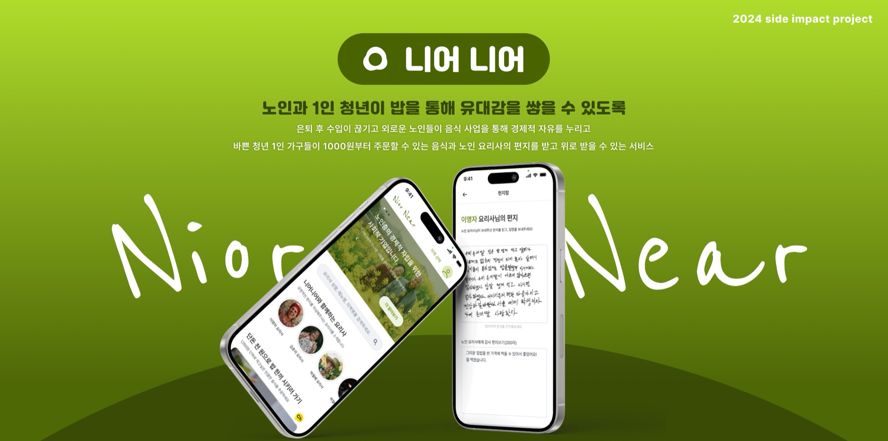

## 서비스 소개


## 1. Stack Info

- JAVA 17
- SpringBoot 3.2.1
- Build Tool Gradle 0 groovy

### Dependencies

- Spring Web, H2(로컬용), JPA, Lombok, MySql

## 2. 프로젝트 구조
```
niornear
├── ServerApplication.java
├── domain
│   ├── letter
│   │   ├── api
│   │   │   └── LetterController.java
│   │   ├── application
│   │   │   ├── LetterService.java
│   │   │   └── LetterServiceImpl.java
│   │   ├── dto
│   │   │   ├── request
│   │   │   │   └── ThankLetterRequestDto.java
│   │   │   └── response
│   │   │       ├── LetterResponseDto.java
│   │   │       └── ThankLetterResponseDto.java
│   │   ├── entity
│   │   │   ├── Letter.java
│   │   │   └── LetterStatus.java
│   │   ├── exception
│   │   │   └── handler
│   │   │       └── LetterExceptionHandler.java
│   │   ├── repository
│   │   │   └── LetterRepository.java
│   │   └── utils
│   │       └── init.md
│   ├── order
│   │   ├── api
│   │   │   └── OrderController.java
│   │   ├── application
│   │   │   ├── MyOrderMenuResponseDto.java
│   │   │   ├── OrderCommandService.java
│   │   │   ├── OrderCommandServiceImpl.java
│   │   │   ├── OrderQueryService.java
│   │   │   └── OrderQueryServiceImpl.java
│   │   ├── dto
│   │   │   ├── request
│   │   │   │   └── OrderAddRequestDto.java
│   │   │   └── response
│   │   │       ├── OrderAddResponseDto.java
│   │   │       └── OrderGetResponseDto.java
│   │   ├── entity
│   │   │   ├── Order.java
│   │   │   ├── OrderMenu.java
│   │   │   ├── OrderStatus.java
│   │   │   └── Place.java
│   │   ├── exception
│   │   │   └── handler
│   │   │       └── OrderHandler.java
│   │   ├── repository
│   │   │   ├── OrderMenuRepository.java
│   │   │   └── OrderRepository.java
│   │   └── utils
│   │       └── init.md
│   ├── payment
│   │   ├── api
│   │   │   ├── PaymentController.java
│   │   │   └── RenderingController.java
│   │   ├── application
│   │   │   ├── PaymentService.java
│   │   │   └── PaymentServiceImpl.java
│   │   ├── dto
│   │   │   ├── request
│   │   │   │   ├── PayStatusRequestDto.java
│   │   │   │   ├── PaymentCallbackRequest.java
│   │   │   │   └── RequestPayDto.java
│   │   │   └── response
│   │   │       ├── PayStatusResponseDto.java
│   │   │       └── PaymentResponseDto.java
│   │   ├── entity
│   │   │   ├── Payment.java
│   │   │   └── PaymentStatus.java
│   │   ├── exception
│   │   │   └── handler
│   │   │       └── PaymentHandler.java
│   │   └── repository
│   │       └── PaymentRepository.java
│   ├── store
│   │   ├── api
│   │   │   ├── HomeController.java
│   │   │   ├── RegionController.java
│   │   │   └── StoreController.java
│   │   ├── application
│   │   │   ├── HomeService.java
│   │   │   ├── HomeServiceImpl.java
│   │   │   ├── RegionService.java
│   │   │   ├── RegionServiceImpl.java
│   │   │   ├── StoreCommandService.java
│   │   │   ├── StoreCommandServiceImpl.java
│   │   │   ├── StoreQueryService.java
│   │   │   └── StoreQueryServiceImpl.java
│   │   ├── dto
│   │   │   ├── request
│   │   │   │   ├── CompanyChefRegistrationRequestDto.java
│   │   │   │   ├── FreelanceChefRegistrationRequestDto.java
│   │   │   │   ├── MenuAddRequestDto.java
│   │   │   │   └── UpdateRegionRequestDto.java
│   │   │   └── response
│   │   │       ├── ChefRegistrationInfoResponseDto.java
│   │   │       ├── ChefRegistrationResponseDto.java
│   │   │       ├── HomeResponseDto.java
│   │   │       ├── MenuAddResponseDto.java
│   │   │       ├── PlaceRegionGetResponse.java
│   │   │       ├── RegionsGetResponseDto.java
│   │   │       ├── StoreResponseDto.java
│   │   │       └── StoreSearchResponseDto.java
│   │   ├── entity
│   │   │   ├── Auth.java
│   │   │   ├── Menu.java
│   │   │   ├── Region.java
│   │   │   ├── Store.java
│   │   │   ├── StoreAuth.java
│   │   │   └── StoreImage.java
│   │   ├── exception
│   │   │   └── handler
│   │   │       └── StoreHandler.java
│   │   ├── repository
│   │   │   ├── AuthRepository.java
│   │   │   ├── MenuRepository.java
│   │   │   ├── PlaceRepository.java
│   │   │   ├── RegionRepository.java
│   │   │   ├── StoreAuthRepository.java
│   │   │   ├── StoreImageRepository.java
│   │   │   └── StoreRepository.java
│   │   └── utils
│   │       └── init.md
│   └── user
│       ├── api
│       │   └── MemberController.java
│       ├── application
│       │   ├── MemberService.java
│       │   ├── MemberServiceImpl.java
│       │   └── OAuth2MemberServiceImpl.java
│       ├── dto
│       │   └── response
│       │       ├── MyMemberResponseDto.java
│       │       └── MyPaymentSummaryResponseDto.java
│       ├── entity
│       │   ├── Account.java
│       │   ├── CustomOAuth2Member.java
│       │   ├── LikeStore.java
│       │   ├── LoginHistory.java
│       │   ├── Member.java
│       │   └── UserAuthorization.java
│       ├── exception
│       │   └── handler
│       │       └── MemberExceptionHandler.java
│       └── repository
│           ├── LoginHistoryRepository.java
│           └── MemberRepository.java
└── global
    ├── auth
    │   ├── WebSecurityConfiguration.java
    │   ├── dto
    │   │   └── NaverAccessTokenInfoResponseDto.java
    │   ├── handler
    │   │   └── OAuth2SuccessHandler.java
    │   ├── init.md
    │   └── jwt
    │       ├── JwtAuthenticationFilter.java
    │       ├── JwtProvider.java
    │       └── TokenParser.java
    ├── common
    │   ├── AwsS3.java
    │   ├── BaseResponseDto.java
    │   └── ResponseCode.java
    ├── config
    │   ├── AsyncConfig.java
    │   ├── AwsS3Config.java
    │   ├── IamportConfig.java
    │   └── WebConfig.java
    ├── error
    │   ├── GeneralException.java
    │   └── handler
    │       ├── AwsS3Handler.java
    │       └── MasterExceptionHandler.java
    ├── infra
    │   ├── HealthCheckController.java
    │   └── ProfileCheckController.java
    └── util
        ├── AwsS3Service.java
        ├── FileService.java
        ├── SmsService.java
        └── Time.java
```

## 3. 인프라 아키텍처


## 4. 배포 과정
[운영 서버]


[개발 서버]


## 5. 브랜치 전략


- `master`는 언제든지 배포가 가능한 상태(릴리즈)
- 새로운 프로젝트는 `develop`을 기반으로 별도 `feature` 브랜치를 생성하여 작업을 진행함
- 브랜치는 로컬에 commit하고, 정기적으로 원격 브랜치에 push함
- 피드백이나 도움이 필요하거나,코드 병합 할 준비가 되었다면 pull request를 만듬
- 다른사람이 변경된 코드를 검토 한 뒤 승인하면 `master`에 병합함
- 병합된 `master`는 즉시 배포할 수 있으며, 배포 해야만 함

## 6. 커밋 컨벤션


출처 : https://puleugo.tistory.com/165

### 예시(깃모지 사용)


## 7. 코드 컨벤션

### 🐫 함수명, 변수명은 카멜케이스로 작성합니다.

### for문 / if문은 다음과 같이 기입합니다. (한 칸 띄어쓰기)

```java
List<HouseResponseDto> houseResponseDtoList = new ArrayList<>();
for (House house : findHouses) {
        List<Review> reviewList = reviewRepository.findAllByHouse(house);
        if (reviewList.size() == 0) {
            houseResponseDtoList.add(HouseResponseDto.of(house, 0, 0));
            continue;
        }           
```

```java
Optional<CardLike> cardLike = cardLikeRepository.findByCardIdAndUserId(id, user.getId());
if(cardLike.isEmpty()) {
        cardLikeRepository.saveAndFlush(CardLike.of(card.get(), user));
        return ResponseEntity.ok().body(MessageResponseDto.of("좋아요 추가", HttpStatus.OK));
} else {
        cardLikeRepository.delete(cardLike.get());
        return ResponseEntity.ok().body(MessageResponseDto.of("좋아요 취소", HttpStatus.OK));
}
```

### 주석 예시

```java
// 댓글 수정
@Transactional
public ResponseEntity updateComment(Long id, CommentRequestDto commentRequestDto, User user){

    // 해당 id의 댓글이 DB에 있는지 확인
    Optional<Comment> comment = commentRepository.findById(id);
    if (comment.isEmpty()) {
        throw new IllegalArgumentException("해당 댓글이 존재하지 않습니다.");
    }
}
```

### 연산자 사이에는 공백을 추가하여 가독성 높이기

```java
a+b+c+d // bad
a + b + c + d // good
```

### 콤마 다음에 값이 올 경우 공백을 추가하여 가독성을 높입니다.

```java
int[] num = {1,2,3,4,5,6,7,8,9}; //bad
int[] num = {1, 2, 3, 4, 5, 6, 7, 8, 9}; //good
```

---

### Refactoring 이후 추가된 부분

1️⃣ **클래스명 뒤에는 한 칸 띄어쓰기, 위에 첫 줄 띄어쓰기 아래는 한 줄 띄어쓰기**

```java
public class AdminController {
                                                                               
  private final AdminService adminService;

  @Operation(summary = "회원가입 API", description = "회원을 등록합니다.")
  @ResponseStatus(value = HttpStatus.OK)
  @Secured(PositionEnum.Authority.ADMIN)
  @PostMapping("/signup")
  public SuccessResponse signup(@Valid @RequestBody SignupRequestDto signupRequestDto, @AuthenticationPrincipal UserDetailsImpl userDetails) {
      return adminService.signup(signupRequestDto, userDetails.getMember());
  }                                                                      
}
```

2️⃣ **import 해서 쓸 때는 줄 띄어쓰기 (X)**

```java
private final PostRepository postRepository;
private final CategoryRepository categoryRepository;
private final KeywordRepository keywordRepository;
private final EmitterRepository emitterRepository;
```

3️⃣ **변수 선언 다음 메소드 오면 줄바꿈 해 주세요.**

```java
Optional<Post> findPost = postRepository.findById(id);
                                                                             
if (findPost.isEmpty()) {
        throw new IllegalArgumentException("해당 게시글이 없습니다.");
} else if (member.getPosition().getNum() < findPost.get().getModifyPermission().getNum()) {
        throw new IllegalArgumentException("수정 가능한 회원 등급이 아닙니다.");
}
```

4️⃣ **else if는 앞에만 띄어쓰기 해 주세요.**

```java
if(post.isEmpty()) {
    throw new IllegalArgumentException("해당 게시글이 없습니다.");
} else if(member.getPosition().getNum() < post.get().getReadablePosition().getNum()){
    throw new IllegalArgumentException("읽기 가능한 회원 등급이 아닙니다.");
}
```

5️⃣ **“}” 사이의 return문은 띄어쓰기를 해 주세요.**

```java
	  }
                                                                         
    return key.toString();
}
```

6️⃣ **메서드 명과 다음 줄은 띄어쓰기 해 주세요.**

```java
@Transactional
public SuccessResponse createBookMarkFolder(String folderName, Member member){
                                                                                          
    Optional<Member> findMember = memberRepository.findById(member.getId());
		...
}
```
